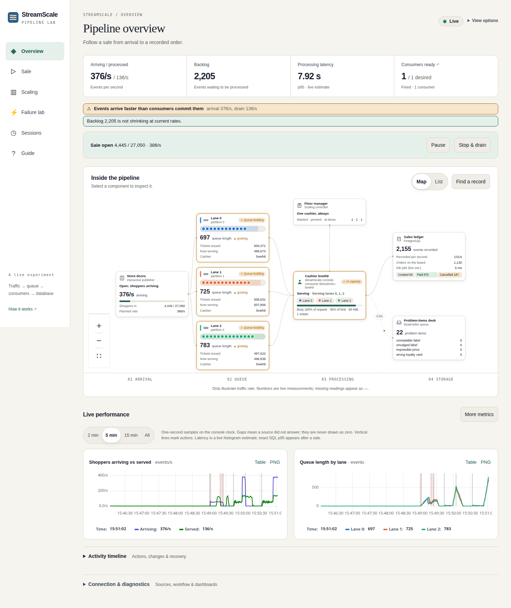
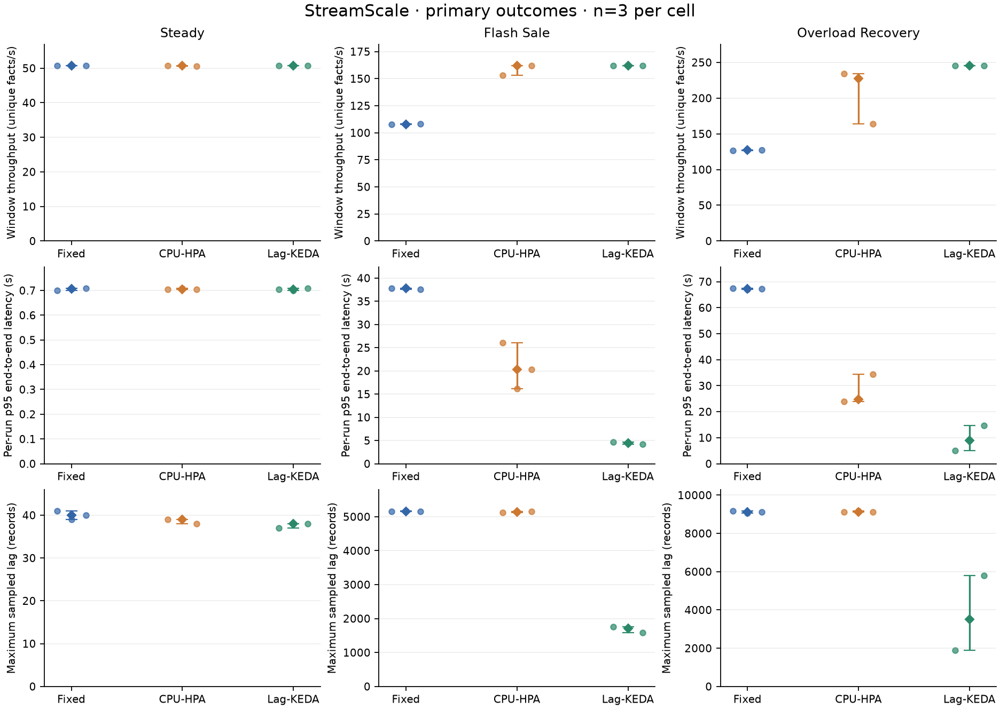
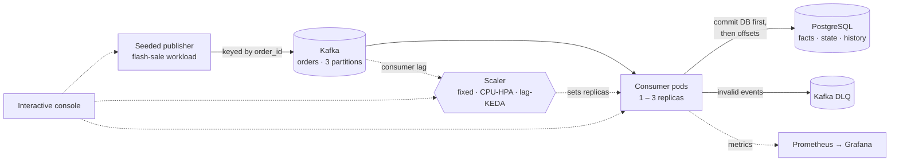

<div align="center">

# StreamScale

**How should a Kafka consumer scale when a flash sale hits?**

A measured comparison of **fixed**, **CPU-based (HPA)** and **lag-based (KEDA)** autoscaling
for a Kafka → PostgreSQL order pipeline, with an interactive console to watch it happen live.


[Quick start](#quick-start) · [Results](#results) · [Console](#the-interactive-console) · [How it works](#how-it-works) · [Docs](#documentation)



<sub>The console mid-sale: shoppers arrive at 376/s, the single fixed consumer drains 136/s, and every lane's queue is growing.</sub>

</div>

---

## At a glance

| | |
| --- | --- |
| **Question** | Under a sudden traffic surge, which scaling policy keeps end-to-end latency lowest, and what does it cost? |
| **Answer (this setup)** | Scaling on **Kafka lag** cut flash-sale p95 latency from **37.8 s to 4.5 s**, about 8× lower than a fixed consumer and 4× lower than CPU-based scaling, using roughly twice the pod time. |
| **Evidence** | 27 measured runs (3 scenarios × 3 modes × 3 repetitions). Every run reconciled exactly against Kafka, SQL and the DLQ, before and after a restart. |
| **Run it** | `./streamscale.sh all`: one command sets up, tests, deploys, measures, plots and opens the console. |

---

## Quick start

**You need:** Docker Engine (running) with Compose · Python 3.12 + [uv](https://docs.astral.sh/uv/) · `make` · Node.js 20.19+ with npm · Google Chrome (for browser checks)

```sh
./streamscale.sh all          # everything, end to end, then opens the console
./streamscale.sh all --no-ui  # same checks, exits when verification finishes
```

`all` prepares the environment, runs local and fault checks, deploys a fresh kind
cluster, exercises all three scaling modes, runs or reuses the measured experiment,
regenerates the report and runs console acceptance. It then serves the console with
Grafana and Prometheus links. The first run downloads images and tools; a fresh
measured campaign can take over an hour.

### Everyday commands

| Command | What it does |
| --- | --- |
| `./streamscale.sh console` | Deploy and serve the interactive console (prints a login link) |
| `./streamscale.sh cluster` | Deploy and verify a fresh run on the kind cluster |
| `./streamscale.sh scaling` | Exercise fixed / CPU-HPA / lag-KEDA and their 1–3 replica bounds |
| `./streamscale.sh experiments [--fresh]` | Run or resume the 27-run measured campaign |
| `./streamscale.sh analysis` | Re-audit raw measurements and regenerate plots, report and PDF |
| `./streamscale.sh ui` | Open Grafana and Prometheus port forwards |
| `./streamscale.sh status` | Show this project's containers and Kubernetes resources |
| `./streamscale.sh stop` / `resume` | Stop or restart project services. **All data is kept.** |
| `./streamscale.sh help` | Full command list |

Run `./streamscale.sh help` for every option. The [run guide](docs/run-project.md)
covers each stage, expected outputs, manual `make` targets and shutdown/resume.

---

## Generalized testing engine — preview

StreamScale now includes an adapter-based experiment runner for independent
Kafka → worker → PostgreSQL applications, with seeded load, bounded fault hooks,
output reconciliation, CI verdicts and matched baseline/candidate campaigns.
The telemetry example uses its own schema and worker without StreamScale imports.

```sh
./streamscale.sh engine-check  # normal independent worker passes; lossy version fails
./streamscale.sh engine --help # run / compare an already running application
```

See [the engine guide](docs/engine.md) for adapter contracts, scenarios, evidence,
exit codes and current limitations. The original demo and console remain available.
M16 remains a preview; [independent Kafka/SQL acceptance passed in CI](https://github.com/1amKhush/StreamScale/actions/runs/40547707151).
These checks do not establish cloud capacity or production readiness.

---

## Results

Three scenarios: a **steady** 52 events/s, a **flash-sale** surge to 390 events/s,
and an **overload-recovery** test. Each scenario × mode cell was measured three times
in randomized order. Values are medians.

| Flash-sale scenario | p95 latency | Peak backlog | Throughput | Pod time used |
| --- | ---: | ---: | ---: | ---: |
| Fixed (1 consumer) | 37.8 s | 5,150 | 108 facts/s | 90 replica·s |
| CPU-HPA (1–3) | 20.4 s | 5,144 | 162 facts/s | 128 replica·s |
| **Lag-KEDA (1–3)** | **4.5 s** | **1,714** | **162 facts/s** | 173 replica·s |

- **Steady load:** all three modes are indistinguishable (≈0.70 s p95, one consumer). Autoscaling costs nothing when it isn't needed.
- **Surges:** KEDA reacts to the backlog itself, so it scales out before CPU climbs. CPU-HPA scales later and less consistently.
- **Overload recovery:** both autoscalers recover in about 40 s versus 87 s fixed, and KEDA keeps the lowest p95 (9.0 s vs 24.8 s HPA, 67.3 s fixed).

<p align="center">
  
</p>

**Read the full analysis:** [measured report](docs/results/current/report.md) ·
[presentation (PDF)](docs/results/current/presentation.pdf) ·
[raw summary CSV](docs/results/current/summary.csv) ·
[experiment protocol](docs/experiments.md)

> [!NOTE]
> These are descriptive results from three repetitions on a single local kind node
> that shares CPU with Kafka, PostgreSQL and monitoring. No statistical significance,
> production or multi-node performance, or exactly-once delivery is claimed. The
> [report](docs/results/current/report.md) lists every limitation.

---

## The interactive console

`./streamscale.sh console` opens a browser console for the **real** running cluster.
You can start a sale, watch the backlog build, switch scaling policy mid-surge,
crash a consumer and watch it recover. It explains the pipeline as a supermarket
checkout, with the real Kafka and Kubernetes names always visible:

| In the store | In the pipeline |
| --- | --- |
| 🛒 Shoppers | Order events from the publisher |
| 🧾 Checkout lanes | Kafka partitions (3) |
| 🧑‍💼 Cashiers | Consumer pods (1–3) |
| 📋 Floor manager | Scaling controller (fixed, manual, HPA or KEDA) |
| 📒 Sales ledger | PostgreSQL |
| 🗂️ Problem-items desk | Dead-letter queue |

| Page | Use it to |
| --- | --- |
| **Overview** | Watch live flow, backlog and latency on the pipeline map |
| **Sale** | Plan, start, pause, change the rate of, or drain a sale |
| **Scaling** | Switch policy or take over manually |
| **Failure lab** | Inject bounded faults (crashes, outages) and watch recovery |
| **Sessions** | Replay, reconcile and compare past runs |
| **Guide** | Five guided demonstrations |

See the [console guide](docs/console.md) for a walkthrough and its safety scope.

---

## How it works



**Correctness rules the pipeline enforces:**

- **At-least-once, never lossy.** Each event's PostgreSQL transaction commits *before* its Kafka offset, so a crash replays the event and never drops it.
- **Idempotent storage.** Run-scoped event IDs make replayed duplicates harmless. Order state never moves backwards.
- **Nothing silently discarded.** Invalid events go to a DLQ, and the offset is committed only after the DLQ write is acknowledged.
- **Exact money.** Prices travel as decimal strings, never floats.
- **Every run reconciles.** Published acknowledgements, SQL rows and DLQ entries are checked against each other with zero missing IDs and zero lag after drain.

The design decisions are recorded in the [event contract](docs/contract-v1.md).

---

## Project layout

```text
streamscale.sh        single entry point for every stage
src/streamscale/      consumer, storage, DLQ, metrics, contract helpers
tools/workload/       seeded workload generator and acknowledged publisher
db/migrations/        checksum-protected SQL schema
schemas/              versioned event and DLQ JSON Schemas
deploy/local/         Docker Compose: Kafka (KRaft) + PostgreSQL
deploy/k8s/           kind cluster, Helm chart, scaling addons, verification
experiments/          pilot, frozen 27-run matrix, audit, plotting
console/              console API, in-cluster agent, React UI
tests/                unit and live integration tests
docs/                 guides, evidence and results
```

---

## Documentation

| Guides | Design | Results |
| --- | --- | --- |
| [Run the project](docs/run-project.md) | [Event contract](docs/contract-v1.md) | [Measured report](docs/results/current/report.md) |
| [Interactive console](docs/console.md) | [Fault handling](docs/fault-handling.md) | [Presentation walkthrough](docs/presentation.md) |
| [Local development](docs/local-development.md) | [Scaling modes](docs/scaling.md) | [Reproduction](docs/reproduction.md) |
| [Workload & consumer](docs/workload-and-consumer.md) | [Experiment protocol](docs/experiments.md) | [Milestone tracker](docs/milestones.md) |
| [Cluster & metrics](docs/deployment-and-metrics.md) | [Console plan](docs/interactive-console-plan.md) | |

<details>
<summary><b>Milestone evidence (M0–M15)</b>: commands run, observed results and review notes</summary>

<br>

| Stage | What it delivered | Evidence |
| --- | --- | --- |
| M0–M1 | Event contract, local Kafka + PostgreSQL, smoke test | [m0-m1](docs/m0-m1-evidence.md) |
| M2–M3 | Seeded publisher, transactional consumer, crash replay | [m2-m3](docs/m2-m3-evidence.md) |
| M4 | Outages, DLQ failures, restarts and rebalances | [m4](docs/m4-evidence.md) |
| M5 | Container, kind/Helm deployment, Prometheus + Grafana | [m5](docs/m5-evidence.md) |
| M6 | Fixed / CPU-HPA / lag-KEDA modes with 1–3 bounds | [m6](docs/m6-evidence.md) |
| M7 | Pilot-calibrated, frozen 27-run measured matrix | [m7](docs/m7-evidence.md) |
| M8 | Audited plots, report and presentation | [m8](docs/m8-evidence.md) |
| M9 | Console API, agent and live telemetry | [m9](docs/m9-evidence.md) |
| M10 | Live pipeline map, charts and inspector | [m10](docs/m10-evidence.md) |
| M11 | Interactive sale controls | [m11](docs/m11-evidence.md) |
| M12 | Scaling modes and manual override | [m12](docs/m12-evidence.md) |
| M13 | Failure lab and recovery | [m13](docs/m13-evidence.md) |
| M14 | Replay, comparison and guided demos | [m14](docs/m14-evidence.md) |
| M15 | Full browser-to-pipeline acceptance | [m15](docs/m15-evidence.md) |
| UI | Focused task pages and mobile layout | [ui-refinement](docs/ui-refinement-evidence.md) |

The complete M0–M15 launcher, including live-cluster and browser acceptance, passed on 2026-10-12.

</details>

<details>
<summary><b>Ports, credentials and data</b></summary>

<br>

| Service | Default address |
| --- | --- |
| Console | `http://127.0.0.1:18080` (login link printed on start) |
| Grafana | `http://127.0.0.1:13000/d/streamscale` |
| Prometheus | `http://127.0.0.1:19090` |
| Local Kafka | `127.0.0.1:19092` |
| Local PostgreSQL | `127.0.0.1:15432` |

- Everything binds to loopback only. A busy port falls back to a free one, so use the URL the command prints.
- Local credentials are in `.env`, created from `.env.example` on first run. Grafana's login is in `artifacts/k8s/credentials.json`.
- Every run gets a fresh run ID and consumer group, and earlier runs, SQL rows and artifacts are never overwritten. `stop` keeps all volumes and cluster nodes.

</details>
