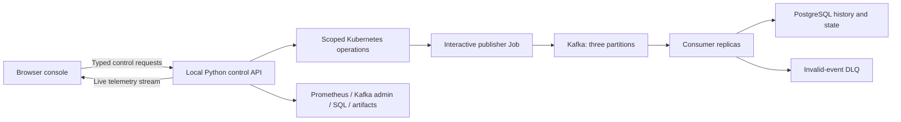

# StreamScale interactive console execution plan

Status: approved scope, 2026-10-10; implementation started 2026-10-12 on the
`interactive-console` branch. M0–M8 remain the existing baseline.

## Product goal

Provide a browser console where a user can start a flash sale, watch events move
through Kafka and consumer replicas into PostgreSQL or the DLQ, change scaling
strategy, inject a failure, and observe recovery and correctness. The console
controls the real local kind deployment. Historical replay is separately labelled.

Insufficient consumer capacity normally creates backlog and higher latency. It
does not guarantee a process crash. Backlog, violated latency targets, unavailable
services, and actual process crashes therefore have distinct visual states. Actual
crashes are demonstrated through explicit fault actions and observed exit reasons.

## Best-fit analogy: a supermarket checkout during a flash sale

The console explains the real pipeline through one consistent analogy. A
**Store** lens uses the analogy's words; a **System** lens uses Kafka, Kubernetes
and SQL names. Both lenses render the same live data, and every analogy label
keeps its technical name visible as a caption.

A checkout fits better than a kitchen, airport or post office because the
domain is already a sale, and the lane/cashier relationship has the same hard
limit as partitions and consumers: one lane is served by one cashier at a time,
one cashier may cover several lanes, and a fourth cashier at three lanes would
stand idle. Queue length is a direct picture of lag.

| Store lens | System lens | Where the analogy stops |
| --- | --- | --- |
| Shoppers arriving through the doors | Interactive publisher producing order events | One order normally creates two events. |
| Loyalty-card lane rule | `order_id` key hashed to one partition | Routing is deterministic, not a shopper's choice. |
| Checkout lanes 0–2 | Partitions 0–2 of `orders.events.v1` | Kafka keeps records after they are read. |
| Ticket dispensed / "now serving" board | High watermark / committed group offset | |
| Queue length | Partition lag | |
| Cashier, lanes covered | Consumer pod, partition assignment | |
| Lane handover | Group rebalance | Every cashier briefly stops during a handover. |
| Floor manager's staffing rule | Fixed, manual, CPU-HPA or lag-KEDA control | |
| "Cashiers look busy" rule | CPU HPA (target utilisation) | Cashiers waiting on the ledger do not look busy. |
| "Queues are long" rule | KEDA Kafka lag threshold | |
| Sales ledger / order status board | `order_event` facts / `order_state` latest state | |
| Problem-items desk | `orders.events.dlq.v1` with a reason | |
| Write the ledger, then advance the board | DB commit before offset commit | Replay after a crash is expected. |
| Receipt-number check | `event_id` duplicate detection | |
| Late slip filed but board unchanged | Late event stored; projection not rolled back | |
| Wait time | `produced_at` to committed SQL fact | |

## Additive implementation constraints

The retained M7 campaign fingerprint covers `src/`, `tools/workload/`, `schemas/`,
`db/migrations/`, `pyproject.toml`, `uv.lock`, the experiment runner files and
`deploy/k8s/`. Changing any of them would make the maintained `all` workflow
refuse the audited 27-run matrix. The console is therefore strictly additive:

- `console/` has its own locked Python and Node dependencies.
- A separate `streamscale-console` Helm release adds an in-cluster agent and
  console consumers, sharing the existing Kafka, PostgreSQL and runs volume.
- Console consumers run the unchanged `streamscale.consumer.consume` loop from
  the deployed image. Test-only fault hooks wrap it inside the console process.
- Console pods do not carry the main chart's Prometheus consumer labels, so
  `deploy/k8s/verify.py` still sees exactly one measured consumer target. The
  agent samples console consumers directly.
- Console runs live under `/runs/console/`, use fresh run/group IDs, and record
  `"interactive": true`. They never enter the M7 comparison.
- The in-cluster agent owns publishing and temporary-fault recovery timers, so
  closing the browser or console server does not leave a fault unrecovered.
  Its Kubernetes role names the exact resources it may scale, patch or delete.

## Screen layout

- Top bar: active run, sale phase/countdown, scaling mode, connection freshness,
  Start/Pause/Resume/Stop sale, and Recover pipeline.
- Centre: zoomable topology with publisher, three Kafka partitions, dynamically
  rendered consumer pods, validation stages, SQL history/state and DLQ.
- Right inspector: selected component status, assignments, resource usage,
  offsets, bounded event samples, logs and available actions.
- Bottom: synchronized charts and timestamped operational timeline.
- Separate pages/tabs: Overview, Sale controls, Failure lab, Run history/compare.

## Complete feature scope

| Area | Included features |
| --- | --- |
| Live flow map | Actual pod/partition topology; sampled animated traffic; per-partition backlog; links from each consumer to owned partitions; accepted/duplicate/late/DLQ branches; DB-before-offset explanation; node health, bottleneck highlights, zoom/fit and component inspector. Animation is a sampled illustration, not a claim of observing every processing step. |
| Sale configuration | Steady, flash-sale and overload/recovery presets; seed; order/event budget; duration and multi-phase rate schedule; pre-run malformed/duplicate/late percentages; validation and estimated event volume; reusable saved presets and repeat settings with a fresh run UUID/group. |
| Sale operation | Start; pause new production while consumers drain; resume; change live publishing rate; end the sale with acknowledged-message flush and backlog drain; explicit abort with a retained partial-run result; publisher progress, confirmed acknowledgements, remaining budget and delivery failures. |
| Scaling | Fixed one consumer; Manual 0–3; CPU-HPA 1–3; lag-KEDA 1–3; change strategy within an interactive session; enter/release manual override; CPU target and lag threshold settings; desired/ready/group-member counts displayed separately; min/max controls within the three-partition cap; scale decision reasons and transition history. Zero manual replicas is labelled stopped processing, not crashed. |
| Metrics and explanations | Publish/accept rates; per-partition/total lag and lag growth; live histogram p95 estimate; exact completed-run SQL p95; CPU, memory, restarts, readiness, DB latency, duplicates, invalids, late events, DLQ outcomes and replica-seconds; separate order and event totals; configurable backlog/latency targets; observed drain rate and a qualified drain-time estimate. Missing/stale measurements remain unknown. |
| Event and data inspection | Bounded event samples; run/order/event lookup; producer acknowledgement, source partition/offset, accepted SQL fact and latest state; validation reason/DLQ envelope; demonstrate duplicate facts remaining unique and late arrivals retaining history without rolling state backward. Intermediate stages are shown only when instrumented; otherwise the UI states the evidence it actually has. |
| Failure lab | Restart a selected consumer; deliberate crash after DB commit before offset commit; crash after DLQ acknowledgement; stop all consumers; consumer processing delay/CPU restriction; temporary PostgreSQL outage; temporary Kafka outage; malformed/duplicate/late fixture presets; bounded, low-memory consumer OOM demonstration; adjustable duration and automatic recovery for temporary faults. Each action displays its actual scope, progress, observed failure and recovery result. |
| Recovery and correctness | Recover the active fault; restore the recorded control configuration; drain backlog; show rebalance/reassignment; reconcile acknowledged valid IDs against SQL facts; check duplicate storage, missing IDs, invalid/DLQ source accounting and latest-state regression; distinguish complete, aborted, recovering and failed runs. |
| Timeline and history | Record rate changes, mode changes, overrides, scaling decisions, faults, pod events, retries and recovery on the same clock as charts; save sessions; timeline playback/scrubbing with speed controls; compare equivalent workloads run sequentially; open the existing 27-run results read-only; export metrics CSV, action log, configuration and charts. |
| Presentation and usability | Guided “no scaling”, “manual rescue”, “CPU vs lag”, “DB bottleneck” and “crash/replay” demos; contextual explanations; full-screen presentation; keyboard controls, labels beyond colour, reduced-motion mode; links to Grafana/Prometheus; reconnect handling and visible command failures. |
| Operation management | Serialized operations, operation IDs, double-click deduplication, progress/cancel where safe, persisted action log, recovery after console restart, and conflict detection with CLI/experiment workflows. Scoped project status/stop/resume controls retain project data. |

## Mode and session rules

| Mode | Controller | Consumer range | Purpose |
| --- | --- | --- | --- |
| Fixed | No autoscaler | 1 | Existing fixed baseline and no-scaling demonstration. |
| Manual | No active autoscaler | 0–3 | Direct experimentation, including pausing consumers and rescuing backlog. |
| CPU-HPA | CPU HPA | 1–3 | Observe CPU-triggered scale-up/down. |
| Lag-KEDA | KEDA and its owned HPA | 1–3 | Observe Kafka-lag-triggered scale-up/down. |

Manual override explicitly suspends/removes the active controller before writing
replicas. Releasing override restores the chosen autoscaler. HPA and KEDA never
compete over the same Deployment. Transitions verify actual controller ownership,
retain the run/group and log mode segments; interrupted transitions expose a
recoverable state instead of reporting success prematurely.

Interactive sessions allow rate/mode/fault changes and are excluded from formal
performance rankings. Controlled comparison runs use frozen settings, fresh IDs
and groups, the same logical workload and reconciliation before ranking. They run
sequentially because this project has one shared broker/database/pipeline.
Historical replay reads artifacts and cannot execute pipeline mutations. Earlier
M7 evidence, fingerprints and reports are never rewritten to accept changed code.

## Architecture and implementation responsibilities



Proposed stack:

- `console/web/`: React + TypeScript, React Flow for the topology, and charts
  sharing one time range. Build to static assets served by the local API.
- `console/server/`: FastAPI; typed REST commands and a WebSocket telemetry
  stream; project adapters, run state machine, operation coordinator and artifact
  reader. It uses explicit kind-streamscale context and approved resource names.
- `console/worker/`: an interactive publisher running inside kind where Kafka's
  advertised service address resolves. The host API reaches its control endpoint
  through scoped forwarding. Reuse event encoding, IDs and acknowledgement rules;
  keep polling delivery callbacks while publication is paused. Rate changes and
  attempted/acknowledged subsets are recorded durably.
- `console/deploy/`: console-only workload/fault overlays and worker image.
- `console/tests/`: command/state tests, browser flows and live reconciliation.
- `artifacts/console/<session>/`: state, action journal, timestamps, samples,
  inspections, exports and recovery information. No arbitrary shell command API.

Keep frontend/API dependencies separately locked from the measured consumer.
Telemetry is collected independently of browser render frequency: roughly one
second for available live counters/lag; resource data follows its actual source
cadence. The browser displays sample time, source and freshness. Kafka inspection
does not join or advance the workload consumer group. SQL inspection is bounded
and read-only. Browser rendering is sampled so a large sale does not create an
unbounded particle or DOM workload.

The API binds to loopback, checks allowed browser origins and uses a local control
session credential. Cluster credentials stay in the backend. Actions target only
StreamScale resources; stop/resume retains the existing project label scoping.
Closing the browser disconnects observation; it does not silently stop the sale
or disable its fault-recovery timer.

## Delivery sequence and acceptance

Owner: coding agent for implementation and evidence; user for product acceptance.
Scope estimates are qualitative. These are proposed milestones, not dated claims
of completed work. Each stage depends on the earlier stages it extends.

| Stage | Scope estimate | Deliverable and dependency | Acceptance and proposed commit |
| --- | --- | --- | --- |
| M9 — Console foundation | Medium | Separate dependency setup, local API, run/component snapshot, telemetry stream, operation contract and read-only browser shell; depends on M0–M8. | Real cluster data loads; disconnected/stale state is explicit; cross-project targets are rejected. `feat: add console API and telemetry foundation` |
| M10 — Live flow | Medium | Topology, charts, inspector, partition ownership, sampled animation and explanatory states; depends on M9. | A real sale changes the map/counters; SQL and DLQ outcomes are inspectable; animation remains usable under burst load and reduced motion. `feat: visualize live pipeline flow and health` |
| M11 — Sale controls | Large | Interactive publisher, session state machine, presets, start/pause/resume/rate change/stop, journal and partial-run handling; depends on M9/M10. | Pausing stops new production while callbacks and consumers progress; stopping flushes acknowledged events; reconnect/restart restores actual state; double-click does not publish twice. `feat: control interactive sale workloads` |
| M12 — Scaling controls | Large | Fixed/manual/CPU-HPA/lag-KEDA, manual override, controller settings, explanations and recovery; depends on M11. | Under overload, 1 consumer accumulates backlog; manual 3 can improve drain when consumers are the bottleneck; both autoscalers respond; transitions preserve offsets and enforce single controller ownership. `feat: control scaling modes and manual override` |
| M13 — Failure lab | Large | Fault actions, bounded resource fixture, temporary fault timers, crash/replay demonstration and reconciliation; depends on M11/M12. | Actual failure reasons appear; pending offsets stay uncommitted during DB failure; crash-after-DB replay yields one fact per ID; recovery reconciles the acknowledged subset; unrelated services remain untouched. `feat: add pipeline failure and recovery lab` |
| M14 — Replay and comparison | Medium | Saved sessions, read-only replay, sequential fair comparison, exports, guided demos and presentation mode; depends on M10–M13. | Replay aligns with recorded actions/metrics; incomplete or changed-setting sessions cannot enter formal rankings; existing 27-run artifacts remain unchanged. `feat: add session replay comparison and guided demos` |
| M15 — End-to-end acceptance | Medium | Complete browser acceptance, console lifecycle checks, final documentation and launcher verification; depends on M9–M14. | Browser starts a sale, demonstrates overload, rescues it, injects/recover a fault and reconciles SQL/DLQ; full maintained launcher passes; committed evidence and copy-paste commands are delivered. `test: verify interactive console end to end` |

Every integrated stage updates `streamscale.sh all`, relevant Make targets,
launcher help, README, `docs/run-project.md` and milestone evidence. M15 completes
acceptance; integration is maintained throughout, not postponed until M15.

M10 is the first useful visualization. M12 is the first complete sale-and-scaling
console. M13 adds the user's crash/recovery demonstrations. Implement and validate
those before expanding history and presentation features.

Proposed future launcher commands (not available yet):

```sh
./streamscale.sh console          # Build/serve console and print the loopback URL.
./streamscale.sh console-check    # Console unit/browser/live acceptance checks.
./streamscale.sh all --no-ui      # Include integrated console checks; no foreground UI.
./streamscale.sh ui               # Keep existing Grafana/Prometheus access.
./streamscale.sh stop             # Existing scoped shutdown; retain data.
./streamscale.sh resume           # Existing scoped resume.
```

Ctrl+C closes the console server and its forwards. Active run state remains
recoverable; temporary faults are owned by a supervised recovery worker rather
than the browser connection. A console Stop sale action ends publishing and drains
consumers; project shutdown is a separate action with visible scope.

## First demonstration to ship

1. Choose Fixed and start the flash-sale preset at one consumer.
2. Watch publish rate exceed acceptance rate, backlog grow and latency worsen.
3. Enter Manual override, scale to three and observe assignments and drain rate.
4. Repeat the same preset with CPU-HPA, then lag-KEDA in fresh runs.
5. Run the crash-after-DB-commit fixture; observe restart, replay and deduplication.
6. Recover and show reconciliation: acknowledged valid IDs retained exactly once
   in fact storage, valid latest state, and accounted-for invalid/DLQ sources.

## Design references

- [React Flow custom nodes](https://reactflow.dev/learn/customization/custom-nodes)
  and [animated edges](https://reactflow.dev/examples/edges/animating-edges).
- [FastAPI WebSockets](https://fastapi.tiangolo.com/advanced/websockets/).
- [Kubernetes manual scaling](https://kubernetes.io/docs/tasks/run-application/scale-deployment/)
  and [KEDA pausing autoscaling](https://keda.sh/docs/2.21/concepts/scaling-deployments/).
