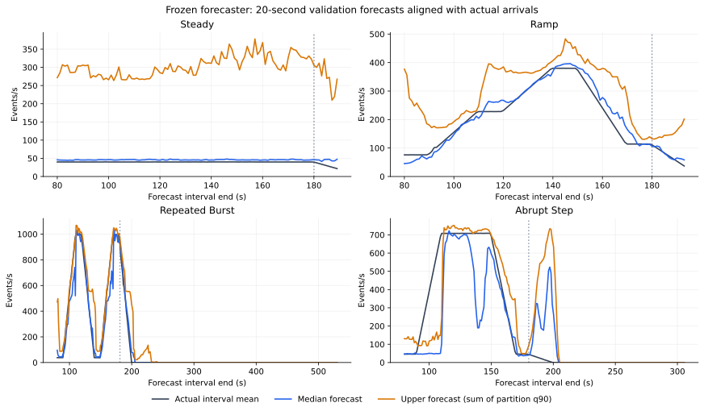
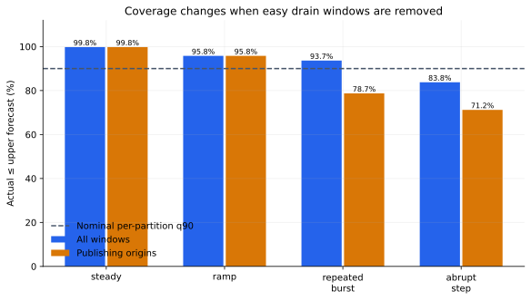
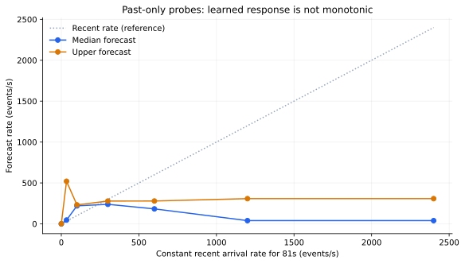
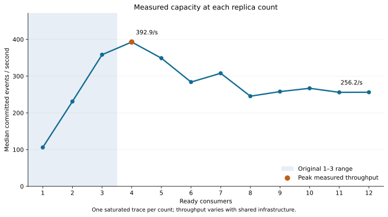

# Predictive model: measured behavior and likely explanations

Updated 2026-11-10. **Current local candidate; live retuning and held-out evaluation
are pending.** The corrected controller passes unit checks, and refitting from the
verified manual traces reproduces the model payload exactly. This is not completed
release acceptance or a performance improvement claim. The [earlier analysis](predictive-model-analysis-before-startup-fix.md) and its artifacts are preserved.

The forecaster recognizes repeated traffic patterns, but its upper estimate is
excessive during steady traffic and misses the start of abrupt surges. The replica
controller also faces a shared processing limit: twelve consumers do not create
more database CPU. These are distinct reasons for apparently surprising behavior.

## What runs during a sale

One shared histogram gradient-boosted model is trained for each combination of
10/20/30-second horizon and .50/.80/.90/.95 quantile: twelve models, each applied
to all twelve partitions. Seven inputs describe observed partition arrivals:
5/10/20/30/60-second averages, plus 5s−60s and 10s−30s differences. There are no
scenario labels, seeds, future schedules or absolute phase clocks. Backlog,
assignments, readiness and database health are collected for the controller;
they are not forecaster features.

Every five seconds the controller tests 1–12 targets using backlog, the larger
of observed and forecast arrivals, measured per-count capacity, partition groups,
startup/rebalance delay and headroom. It chooses the smallest feasible target;
if none is feasible it chooses the lowest projected delay and reports a limit.
Its queue-delay proxy is distinct from exact reconciled SQL p95.

Ax/BoTorch tunes four controller settings offline. It does not predict traffic,
change the trained tree models or run an optimizer during a pilot.

## Forecast accuracy depends on the traffic condition

At 20 seconds and q90, per-partition pinball loss in horizon event-count units is:

| Validation workload | Model | Persistence | Trend |
| --- | ---: | ---: | ---: |
| Steady | 38.28 | 9.06 | 15.55 |
| Ramp | 14.81 | 61.30 | 58.46 |
| Repeated burst | 14.39 | 160.92 | 184.91 |
| Abrupt step | 66.77 | 95.19 | 102.77 |

These are whole-run validation results, with one independent validation run per
family. Overlapping windows and pooled partitions are correlated observations.
Coverage includes ties, including zero-arrival drain windows. The model beating
a baseline forecast loss does not establish better scaling.

Curves place interval-mean forecasts at their future interval ends. Actual labels
use Kafka offset deltas to the first observation at/after the horizon, within two
seconds, normalized by actual elapsed time. Discontinuous windows are excluded.



**Steady overprediction:** mean actual arrivals were 37.36 events/s, median
forecast 44.23, and upper forecast 267.05. The UI's conservative forecast is the
upper value. A plausible reason is that a quiet recent history can also precede
a burst in the training data. Three independent training realizations per family
provide limited evidence to distinguish those cases. This is an inference from
the dataset and model response, not proof about a particular tree split.

**Abrupt-rise misses:** only 3 of 22 future-surge windows were covered by the
aggregate upper estimate. Their mean actual rate was 407.44 events/s versus
204.66 forecast. Overall abrupt-step aggregate coverage was 87.01%, falling to
83.33% for publishing origins. Offline future-surge labels diagnose errors;
they never enter inference. A history-only model has no signal before a new,
unprecedented jump. Rolling averages also dilute the first high observations.

**Easy drain windows:** repeated-burst loss was 14.39 overall and 26.14 during
publishing. Of 202 origins, 102 were after publication ended. Across the twelve
training runs, 20.01% of the 1,654 valid 20-second origins had zero future total
arrivals. Report active and surge performance alongside overall scores.

A sum of partition q90 estimates is not guaranteed to be the total's q90.
Separately fitted quantiles can cross; inference clamps upper values to at least
the median. Neither a quantile label nor coverage on one run guarantees latency. Quantile loss
penalizes underprediction more heavily at high quantiles: at q90, a one-event
underforecast costs nine times a one-event overforecast. It estimates a conditional
quantile rather than a mean. [Estimator documentation](https://scikit-learn.org/1.7/modules/generated/sklearn.ensemble.HistGradientBoostingRegressor.html).



## Why higher past traffic can produce a lower forecast

Valid past-only probes use integer Kafka-like counters and complete histories:

| Observed history | Median events/s | Upper events/s |
| --- | ---: | ---: |
| Constant nominal 34/s | 43.64 | 506.86 |
| Constant 300/s | 227.42 | 227.42 |
| Constant 1,200/s | 23.20 | 245.57 |
| New nominal 1,000/s surge for 2s | 628.71 | 698.72 |
| Same surge observed for 10s | 814.97 | 883.35 |
| Same surge observed for 30s | 47.28 | 388.19 |

These are response probes, not predictions with known future truth. Tree models
have no general extrapolation rule or monotonic constraint here. The sharp fall
after a sustained high segment is consistent with learning short repeated phases
that often end soon. It may fail on unfamiliar plateaus. Current observed-rate
floors help the controller react once actual demand rises, despite underforecast.



Complete-history probes preserve the relationships between rolling averages and
trends. Shuffling individual correlated features could create impossible input
histories; these probes do not establish the cause of an individual tree split.
[Inspection guidance](https://scikit-learn.org/1.7/modules/permutation_importance.html).

## Why four consumers can be preferable to twelve

Fresh separate saturated calibrations measured 392.94 events/s with four consumers
and 256.21 with twelve. These are single traces per count, not replicated causal
experiments. They retain the same database, broker and consumer resource limits.
The controller uses this empirical curve rather than multiplying one-consumer
capacity. Range-assignment projections also conservatively account for uneven
partition groups and startup; stable current assignments use actual groups.

A read-only, 58-second profile during a fully backlogged twelve-consumer trace
found PostgreSQL using 0.499 of its 0.5-core quota, with every sampled scheduling
period throttled. Kafka used 0.236 of its one-core quota without CPU throttling.
This supports database CPU quota as a contributor to the plateau, without proving
it explains every loss or excluding I/O and transaction/coordination costs.

Twelve partitions reveal additional targets, contention and replica-cost tradeoffs
that a three-replica ceiling hides. They do not imply proportional throughput.
Keep resource limits fixed for this comparison; resource changes require fresh
compatibility checks and capacity calibration. The [CPU quota profile](results/capacity-12/loaded-cpu-profile.json) and [capacity data](results/capacity-12/calibration-current.csv) identify the observations.



## Why forecast, recommended, desired and ready counts differ

The controller first needs 60 seconds of fresh observed history and uses reactive
capacity recommendations during warm-up. The first repeated burst starts before
forecasting is ready. Restarting or discontinuous history requires rebuilding it.

Downscaling stabilizes for 60 seconds by default and removes at most one replica
per action. In one recorded default-policy decision, observed arrivals were
87.99/s and the upper forecast was 227.44/s. Three replicas were recommended,
but desired and ready remained four, explicitly because stabilization was active.
Readiness and rebalance delays can create further differences.

Under the previous controller, the first default-policy tuning ramp reconciled correctly at exact SQL p95
1.2148 seconds. Its repeated burst also reconciled correctly but missed the
objective at 49.707327 seconds. Both had continuous measurement coverage. These
are historical tuning workloads, not the held-out comparison or a completed optimum.

Historical startup/reconciliation memory failures and a 3,710-second observation
gap are preserved separately. They cannot establish normal model performance.
The measurement gate excludes incomplete replica-cost intervals and keeps SQL
correctness separate from latency success.

## A confirmed controller error, separate from the forecaster

The old controller compared targets at different future timestamps. A changed
replica count received startup delay plus the complete forecast horizon; the
unchanged target received only the horizon. This gave changed targets extra
time to drain. In a deterministic case using the actual calibration, it chose
three consumers with a projected 6.32 seconds over four with 16.02 seconds.
At one common future timestamp the values are 18.33 and 16.02: four is better.

The correction compares every target at `max(forecast horizon, readiness delay)`.
It holds the forecast mean rate through that planning window and subtracts
startup from the new target's service interval. `projection_seconds` records
that window; the traffic chart continues to show the actual forecast horizon.
Three analytical cases cover zero startup, a slower downscale and readiness
beyond the forecast horizon. All **213 pipeline and 193 console unit tests pass**.
[Counterexample and corrected scores](results/capacity-12/projection-horizon-counterexample.json).

One old policy downscaled from four to three with 17,349 events still queued,
then returned to four shortly afterward. The unequal windows help explain that
avoidable churn. They do not establish the cause of its complete p95 difference
from another run. Shared capacity variation and forecasting remain separate issues.

The old runtime completed twelve policies and twenty-four correctness-passing
workloads, with no feasible policy: per-policy worst p95 ranged from 48.25 to
123.55 seconds. It correctly retained the conservative default. Those scores are
preserved under their old fingerprint and cannot qualify the corrected controller.
All twenty-eight manual traces remain compatible after source/resource/configuration
and checksum validation. New controlled tuning and thirty-six held-out runs remain
required; no old policy state or controlled capture was copied.

## Improvements supported by this diagnosis

Keep the single ML Predictive mode. Future model work should test more independent
runs with varied durations and sustained plateaus, conditional quantile calibration,
quiet-traffic baselines and history features describing observed stability/burst
age. Retain whole-run splits and untouched final evaluation. Profile shared service
capacity before assuming extra consumers solve overload. Bayesian policy tuning
cannot remove forecast bias or a physical bottleneck.

The current release's forecaster and resources remain frozen during qualification.
Run `./streamscale.sh predictive-analyze` after preparation to regenerate offline
figures. It starts no services and does not retrain, tune, publish or scale.

## Evidence, status and reproduction

The [machine-readable summary](results/capacity-12/model-analysis/summary.json),
[all 288 validation slices](results/capacity-12/model-analysis/validation-slices.csv)
and [past-history probes](results/capacity-12/model-analysis/past-only-probes.csv)
retain model/data identities and whole-run splits. The corrected local candidate
is `ccf0afec3699f317a48e9108218ddeaa33b02fee92a268be4cb896538e512975`,
source `ea0c07a`, campaign
`9320d567df1ad9b7b085169a22b779879ac3de4e453c2d9c693c7cc5fb0c357f`.
It is not installed or promoted. Refit payload matches the previous fit bit-for-bit;
its controller compatibility and preparation fingerprint changed.

The user cancelled remaining qualification for submission on 2026-11-10. Full
live/browser acceptance and complete launcher success/reuse remain unexecuted;
all project services are stopped. No held-out improvement is claimed. Source,
models and raw evidence remain available after disposable dependency/cache cleanup.

After compatible preparation, `./streamscale.sh predictive-analyze` regenerates
accepted-artifact diagnostics with the cluster stopped. To reproduce this candidate:

```sh
OMP_NUM_THREADS=1 OPENBLAS_NUM_THREADS=1 uv run --project experiments/predictive --frozen \
  python -m experiments.analyze_predictive \
  --campaign artifacts/predictive/9320d567df1ad9b7b085169a22b779879ac3de4e453c2d9c693c7cc5fb0c357f
uv run --project experiments/analysis --frozen python -m experiments.plot_predictive \
  --input artifacts/predictive/9320d567df1ad9b7b085169a22b779879ac3de4e453c2d9c693c7cc5fb0c357f/analysis/analysis.json
```

Model payload
`08f5818889e35f96b3edb35a6a068f99f33f34c8279d7a189987148589b7dfb7`,
data hash `febf730e254993bb84efe95d1922d6752472e9ad98ec597ac378b58f09c98fe7`.
