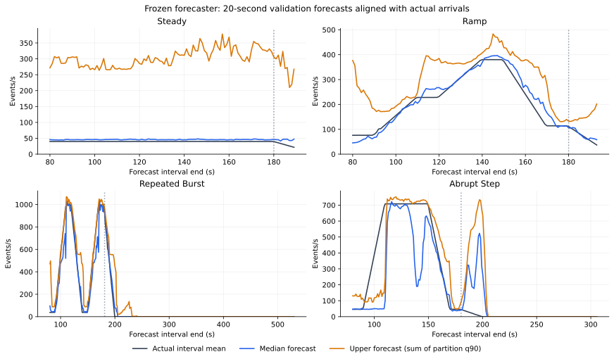
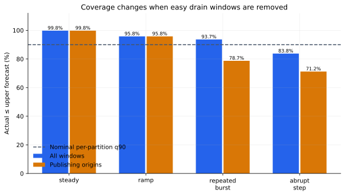
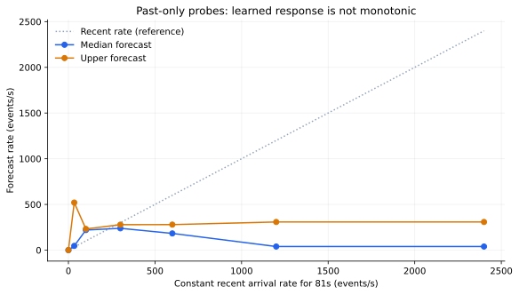

# Why the predictive model behaves this way

Analysis date: 2026-11-10 (India time). **Interim, frozen-model diagnostics**:
the artifact below predates the consumer startup memory correction. Fresh full
qualification is pending. These findings describe observed predictions; they
are not a successful tuning result or held-out performance claim.

The main finding is that this model has learned useful traffic patterns, but
its upper forecast is too conservative on steady traffic and still misses
abrupt rises. Several apparent scaling problems also come from capacity limits,
warm-up, stabilization or interrupted measurements rather than the forecaster.

## What actually runs

There are three separate components:

1. **Traffic forecaster:** twelve histogram gradient-boosted models, covering
   10/20/30-second horizons at quantiles .50/.80/.90/.95. Each predicts future
   arrival counts for a partition. Inputs are only five observed arrival-rate
   averages (5/10/20/30/60 seconds) and two differences (5s−60s and 10s−30s).
   Collected backlog, assignments, ready replicas and DB health do **not** enter
   these seven model features; the controller uses them separately.
2. **Replica controller:** every five seconds it combines current arrivals,
   forecast arrivals, backlog, assignments, measured capacity at each count and
   startup/rebalance delay. It tests 1–12 replicas and selects the smallest
   feasible target or the lowest projected delay when none is feasible.
3. **Offline Bayesian tuner:** Ax/BoTorch searches four controller settings in
   twelve trials. It does not predict traffic, run during a sale, tune the
   forecaster's tree hyperparameters or increase physical processing capacity.

The tree models have 80 boosting iterations, at most 15 leaves per tree and ten
samples per leaf. They use quantile/pinball loss. A high quantile deliberately
penalizes underprediction more than overprediction; it is not an expected mean
or a guarantee that latency stays below two seconds.
[scikit-learn 1.7.2 estimator documentation](https://scikit-learn.org/1.7/modules/generated/sklearn.ensemble.HistGradientBoostingRegressor.html).

The figure aligns forecasts and observed interval means at the **end of their
20-second interval**. The vertical dotted line marks publication ending. Actual
labels use the first observation at/after the horizon, within two seconds, and
normalize by actual elapsed time. Unknown or discontinuous intervals are excluded.



## 1. Why it overpredicts steady traffic

At the default 20-second/.90 setting, the steady validation run averaged
**39.16 actual events/s versus 301.05 forecast events/s**. Its median forecast
is separate; the console's main forecast rate uses the conservative upper value.
Per-partition pinball loss was **43.75**, compared with **9.53** for persistence
and **16.08** for the trend baseline. This is a measured weakness.

A plausible explanation is ambiguity in the short observed history. Low traffic
occurs both in steady runs and before later bursts. The model never receives a
scenario label, phase clock or future schedule. A high conditional quantile can
therefore choose a possible future burst even while the current run stays quiet.
There are only **three independent training realizations per workload family**,
so the learned boundary between these cases has limited support. This is an
inference from the data and model design, not a causal explanation of every tree.

The controller then uses the greater of the upper forecast and current observed
rate. A falsely high upper forecast can cause extra replicas or a conservative
“capacity limited” warning under low actual traffic. That status describes the
projection under its assumptions, not proof that the hardware is currently full.

## 2. Why abrupt spikes still surprise it

The abrupt-step validation run's apparent aggregate coverage was 90.05% over all
windows. During publishing it fell to **82.35%**. For the 22 diagnostic windows
whose future average rose sharply above the recent observed rate, only **one**
aggregate upper forecast covered actual arrivals. Mean forecast was 177.10
events/s versus 435.22 actual events/s in those windows.

Those windows are classified using future outcomes **only for offline diagnosis**;
that information never enters inference. A history-only model cannot identify
an unprecedented jump before any signal appears. Its rolling features also mix
the new high rate with the preceding quiet period. The current-rate floor helps
the controller react after arrivals rise, but it does not provide advance notice.

The controller initially needs 60 seconds of fresh run history. It uses reactive
capacity recommendations during that warm-up. With the existing repeated-burst
schedule, the first burst begins before forecasting is ready. Restarting or
losing contiguous history starts warm-up again.

## 3. Why the overall scores look better than the difficult moments

At 20 seconds, **70.2%** of repeated-burst validation origins occurred after
publication had ended. These easy near-zero drain windows lower its overall
pinball loss from **30.82 during publishing to 10.17 overall**. Abrupt-step loss
similarly changes from **95.89 to 55.45**. Around **20.1%** of pooled training
origins at this horizon have zero future aggregate arrivals.

| Family | Live per-partition upper coverage: all | During publishing |
| --- | ---: | ---: |
| Steady | 99.77% | 99.77% |
| Ramp | 95.80% | 95.80% |
| Repeated burst | 93.65% | 78.71% |
| Abrupt step | 83.77% | 71.22% |



Coverage includes ties and many overlapping windows. There is one validation run
per family; these are descriptive percentages, not independent trials or confidence
intervals. A low overall loss does not establish reliable spike coverage. The
nominal quantile needs checking in the operating conditions that matter.
[scikit-learn's coverage evaluation example](https://scikit-learn.org/1.7/auto_examples/ensemble/plot_gradient_boosting_quantile.html).

The live total also sums twelve per-partition upper forecasts. That sum is not
automatically the 90th percentile of total traffic: dependence between partitions
matters. Independently fitted quantiles can cross; inference raises the upper
forecast to at least the median. Crossing occurs in only 0.08% of the steady
run's partition windows here, so it does not explain the large steady bias.

## 4. Why a larger recent rate can produce a smaller forecast

The model is a collection of tree regions, with no monotonicity constraint or
physical trend-extrapolation rule. Valid past-only probes show:

| Observed past pattern | Forecast median (events/s) | Upper forecast |
| --- | ---: | ---: |
| Constant nominal 34/s for 81s | 46.27 | 520.42 |
| Constant 300/s for 81s | 238.81 | 278.54 |
| Constant 1,200/s for 81s | 39.41 | 308.07 |
| New nominal 1,000/s surge for 2s | 708.84 | 819.55 |
| Same surge observed for 10s | 869.03 | 918.06 |
| Same surge observed for 30s | 40.74 | 414.43 |

These are model-response probes, **not forecasts with known future ground truth**.
Integer partition offsets slightly round nominal per-second rates. The full
probe plot also includes 2,400/s, outside the publisher's configured limit, to
show out-of-distribution response; it is not a proposed workload.



The sharp change after 30 seconds is consistent with learning the preparation
workloads' short repeated phases: a long high segment often precedes a fall.
The same pattern may fail on a sustained, unfamiliar plateau. Similar outputs
at 1,200 and 2,400/s show why extrapolation should not be assumed. These probes
support that hypothesis; they do not prove one particular split caused it.

We use complete past histories for these probes because the seven features are
strongly related: the trends are exact differences of the averages. Independently
shuffling one column could create impossible histories, and correlated features
can make individual importance scores misleading.
[scikit-learn's inspection guidance](https://scikit-learn.org/1.7/modules/permutation_importance.html).

## 5. Why the controller often chooses four rather than twelve

The separately measured historical calibration peaked at **433.95 events/s with
four consumers**, versus **345.96 with twelve**. With 15% headroom, the four-
consumer projection allows about 368.86 events/s before partition skew and other
delays. The repeated-burst tuning peak was **992 events/s**. That exceeds the
calibrated processing curve; even a perfect traffic forecast cannot remove the
need to queue work under those assumptions.

Twelve partitions enable twelve useful consumer assignments, but do not multiply
database, node, transaction or synchronous offset-commit capacity. The curve
demonstrates a shared limit, without isolating its cause.

A later read-only profile during fresh twelve-consumer training provides more
specific evidence: every partition remained backlogged (minimum 636 events),
all twelve consumers were ready, and PostgreSQL averaged **0.499 cores against
its 0.5-core limit** over 58 seconds. Every sampled PostgreSQL scheduling period
was throttled. Kafka averaged **0.236 of its one-core limit**, with no CPU
throttling. This supports PostgreSQL's CPU quota as a contributor to the capacity
plateau. It does not prove that quota alone explains the complete curve or rule
out storage, transaction and coordination costs. The resource limits remain
unchanged across the comparison. See the [loaded CPU profile](results/capacity-12/loaded-cpu-profile.json).

The fresh calibration separately measured 392.94 events/s with four consumers
and 256.21 with twelve. Both this and the historical curve above use one trace
per count; their difference cannot be attributed to the startup memory fix.

The controller also waits for ready pods and stable assignments. Downscaling
requires stabilization and removes at most one replica per action. Predictions,
desired replicas and ready replicas can therefore differ legitimately. The
two-second queue projection is a control proxy, while final p95 comes from every
committed SQL fact; those are different measurements.

## 6. Why some historical runs have exceptionally bad latency

One preserved tuning capture has a **3,710.60-second telemetry gap** and p95
**3,931.04 seconds**. Only 456.08 seconds of its intervals have continuous
measurements. That run cannot establish normal policy performance. Another
large-sale startup OOM was fixed separately; neither failure is evidence that
the model alone caused its latency.

The new performance gate requires positive, continuous intervals no longer
than the existing five-second freshness bound and known ready counts at both
ends. Missing time stays unknown. Such captures cannot train Ax objectives or
complete held-out evaluation; SQL correctness remains a separate result.
Forecast accounting also deduplicates telemetry frames: the first default-policy
sale has 135 forecast-bearing samples, but only **23 distinct forecast origins
with observable future intervals** in its saved capture.

## Confirmed controller projection error

Fresh tuning diagnostics subsequently exposed an error distinct from forecasting:
a changed target received startup time **plus** a full forecast horizon, while
the unchanged target received only the horizon. The comparison therefore gave
changed targets extra time to drain. With the fresh calibration, uniform backlog
and zero arrivals, it chose three consumers at a projected 6.32 seconds rather
than the faster four at 16.02 seconds. Comparing both at the same timestamp gives
18.33 seconds for three and 16.02 for four; four is the correct recommendation.

The correction uses one planning window covering the forecast horizon and startup
delay, subtracting startup from the new target's service interval. Three analytical
regressions cover zero delay, a slower downscale and delay beyond the forecast.
All 213 pipeline and 193 console unit tests pass. Live policy tuning and held-out
evaluation must be repeated under the corrected controller. The 28 manual traces
remain compatible after validation; old policy scores are preserved separately.
See the [counterexample](results/capacity-12/projection-horizon-counterexample.json).

One saved old-controller run downscaled from four to three with 17,349 events
still queued, then returned to four shortly afterward. The defect helps explain
that avoidable churn. It does not establish the cause of the entire latency gap
between that run and the default policy. Forecast bias and shared capacity remain
separate issues.

## What to improve next

Keep the single ML Predictive mode. A later model iteration should prioritize:

- More independent runs, varied burst durations and sustained plateaus, retaining
  whole-run splits and a genuinely untouched final evaluation.
- Conditional quantile calibration and active/surge/drop scores alongside overall
  loss. Assess whether persistence should receive more weight during quiet traffic.
- History features that distinguish observed burst duration and stability without
  exposing schedules, scenario labels, seeds or future data.
- Component profiling before changing capacity assumptions or claiming that more
  replicas solve overload. Bayesian policy tuning cannot fix model bias or a
  shared processing limit.

These are recommendations, not changes to the frozen forecaster in this release.

## Evidence and reproduction

The [compact evidence](results/capacity-12/model-analysis-before-startup-fix/summary.json),
[validation slices](results/capacity-12/model-analysis-before-startup-fix/validation-slices.csv) and
[past probes](results/capacity-12/model-analysis-before-startup-fix/past-only-probes.csv) identify the
frozen model, data hash, training/validation run IDs and historical tuning records.
All 288 family/horizon/quantile/slice combinations remain available, including
empty diagnostic slices. Raw aligned traces stay under ignored `artifacts/`.

For the currently accepted artifact, after preparation:

```sh
./streamscale.sh predictive-analyze
```

This command works with the cluster stopped. It never retrains, selects a policy,
publishes workload or writes replicas. `all` invokes it after evaluation. Outputs
are under `artifacts/predictive/<fingerprint>/analysis/`.

To reproduce this explicitly historical candidate analysis:

```sh
OMP_NUM_THREADS=1 OPENBLAS_NUM_THREADS=1 uv run --project experiments/predictive --frozen \
  python -m experiments.analyze_predictive \
  --campaign artifacts/predictive/b2c38a20bd54fe57fcc198c635f55dd91ec5c6625caaf5a8afe5819f9fd6be5e \
  --output artifacts/capacity/model-analysis-before-startup-fix
uv run --project experiments/analysis --frozen python -m experiments.plot_predictive \
  --input artifacts/capacity/model-analysis-before-startup-fix/analysis.json \
  --output artifacts/capacity/model-analysis-before-startup-fix
```

Historical regeneration requires the matching pre-projection code, such as `b5ab062`; current runtime compatibility checks reject this older model.
