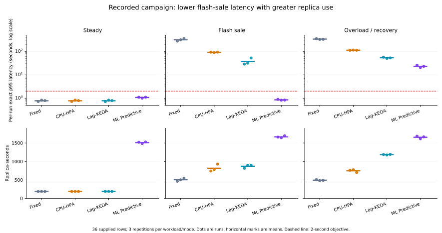
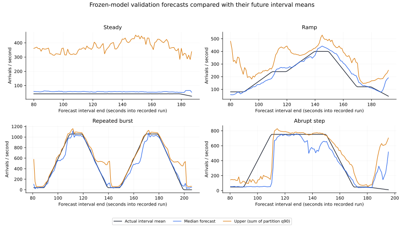
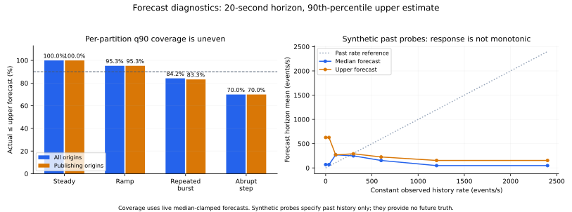

# Predictive model: behavior in the supplied complete run

Updated 2026-11-12. This analysis uses the files supplied in `sim_run/` and the
implementation at evaluated commit `7e01206`. It explains the recorded model and
controller behavior; it is preparation for the final report.

The strongest supported result is a useful latency/resource trade-off: ML
Predictive kept flash-sale p95 below one second in all three repetitions, while
using substantially more replicas. Forecast calibration remains uneven, especially
at abrupt changes and during steady traffic. Good pipeline latency does not by
itself establish accurate forecasts or an optimal resource policy.

[Audited summary](results/capacity-12/sim-run-2026-11-12/summary.json),
[all 36 source rows](../sim_run/summary.csv),
[aggregated outcomes](results/capacity-12/sim-run-2026-11-12/outcomes.csv) and
[original model diagnostics](../sim_run/analysis.json) retain the measurements.
The [2026-11-10 local-candidate analysis](predictive-model-analysis-2026-11-10.md)
and [earlier analysis](predictive-model-analysis-before-startup-fix.md) are historical
snapshots with different models, data and environments.

## What the model and controller each do

The traffic predictor consists of twelve shared `HistGradientBoostingRegressor`
models: three horizons (10/20/30 seconds), each with four quantiles
(.50/.80/.90/.95). These are shared across partitions, rather than twelve
partition-specific models. Each model receives seven past-only partition features:
5/10/20/30/60-second arrival rates, `rate_5s - rate_60s`, and
`rate_10s - rate_30s`. The trends are differences, not normalized ratios.
Training uses 80 boosting iterations, at most 15 leaves per tree, a minimum of
10 window samples per leaf, and fixed random state 42. Backlog, ready replicas
and database health inform the control path; they are not these seven traffic
forecast inputs. Processing capacity is calibrated separately.

Training labels are arrival **counts over the future horizon**. Displayed rates
are those counts divided by the horizon. Thus a 20-second forecast estimates the
next interval's mean arrival rate, rather than the instantaneous rate exactly
20 seconds later. Plots align predictions with the actual mean over that same
future interval. Schedules, seeds, scenario names and future observations are
excluded from inference features.

Rates use actual elapsed time between offset observations. Missing/stale sources,
counter resets, telemetry gaps and run changes are rejected or reset history;
they do not become artificial zero-traffic training/inference samples.

Every five seconds the controller converts the upper forecast to rates, then
uses the greater of forecast and recently observed demand in each partition.
It evaluates all twelve targets using current backlog, empirical capacity at
each count, partition assignments, 15% capacity headroom, and measured startup
and rebalance delay. It chooses the smallest feasible target, or the target with
the least projected delay if none meets the latency proxy. That proxy is distinct
from the exact SQL p95 used to evaluate a finished run.

Readiness and ownership checks gate writes. Downscaling waits for stabilization
and removes at most one replica per action. A fresh run needs 60 seconds of
contiguous history; fresh observations and calibrated capacity drive reactive
recommendations during that warm-up.

Bayesian optimization runs offline between experiments. It tunes controller
parameters, rather than making online traffic predictions. The supplied records
contain **12 candidate policies × 2 workloads = 24 tuning captures**. Every
candidate failed the two-second constraint on at least one tuning workload;
their worst p95 values range from **6.272 to 9.992 seconds**. The default
20s/.90/15%/60s policy was therefore retained with `tuning=infeasible`.
It is not a successful Bayesian optimum.
Here infeasible means none of the twelve tested policies satisfied the joint
constraint; it is not a proof that every possible policy would fail. The default's
ramp p95 was 1.031s, while its repeated-burst p95 was 7.834s.

Source: [features/labels](../src/streamscale/predictive/data.py),
[training/inference](../src/streamscale/predictive/model.py),
[projection](../src/streamscale/predictive/policy.py),
[agent](../console/worker/streamscale_console_worker/predictive.py) and
[offline policy selection](../experiments/predictive/tuning.py).

## What the held-out rows show

Values below are means of the three **per-run p95 values**, not pooled event p95.
All 36 rows report correctness passing, performance eligibility and complete
measurement coverage. Fifteen runs meet the two-second objective; 21 miss it.

| Workload | Fixed p95 (s) | CPU-HPA p95 (s) | Lag-KEDA p95 (s) | ML Predictive p95 (s) | ML target passes |
| --- | ---: | ---: | ---: | ---: | ---: |
| Steady | 0.778 | 0.778 | 0.779 | 1.071 | 3/3 |
| Flash sale | 314.285 | 91.936 | 37.619 | 0.851 | 3/3 |
| Overload/recovery | 336.275 | 112.832 | 53.461 | 23.091 | 0/3 |

| Workload | ML replica-seconds | Lag-KEDA replica-seconds | ML time-weighted ready replicas |
| --- | ---: | ---: | ---: |
| Steady | 1,510.2 | 188.4 | 8.05 |
| Flash sale | 1,665.7 | 870.5 | 8.52 |
| Overload/recovery | 1,655.0 | 1,184.6 | 8.45 |

ML used about **8×** Lag-KEDA's replica-seconds during steady traffic and **1.91×**
during flash sales. Its flash-sale p95 range was 0.825–0.896 seconds, with peak lag
484–760, compared with KEDA's 13,834–28,879. This supports lower observed flash-sale
latency and backlog at higher replica cost in this environment.

## Why steady traffic is overpredicted

At the default horizon/quantile, the steady validation run averages **41.29
actual arrivals/s** and **369.80 forecast arrivals/s** in the aggregate upper
estimate. Its raw per-partition pinball loss is 54.75 versus 10.05 for persistence.
The model is substantially worse than the simple baseline in this family.

A likely cause is conditional ambiguity. Sixty seconds of quiet rates can precede
continued steady traffic or a burst. Those histories can reach similar tree leaves;
the model has no future schedule or elapsed-sale-clock feature to distinguish
them. A 90th-percentile loss penalizes underprediction nine times as strongly
as equal-sized overprediction, encouraging an elevated upper estimate where
future outcomes are mixed.

Only twelve complete training realizations are recorded, with four validation
runs, one per family. The many overlapping partition/time windows do not provide
that many independent traffic realizations. Broad leaves, correlated windows and
limited regime diversity are plausible contributors; the model binary and leaf
assignments are not supplied, so their individual effects cannot be measured here.

The sum of per-partition q90 estimates also has no automatic interpretation as
a calibrated aggregate q90. Partition dependence and separate quantile fits can
make the summed upper rate conservative. Live inference clamps the upper estimate
to at least the median; this prevents crossings against the median but does not
calibrate coverage.

## Why bursts can look good while abrupt onset is missed

Default-horizon validation shows uneven coverage. The table uses the live
median-clamped upper forecast for coverage, and raw-model pinball scores from
the supplied metadata; lower pinball loss is better.

| Validation family | Per-partition q90 coverage | Model pinball | Persistence pinball | Trend pinball |
| --- | ---: | ---: | ---: | ---: |
| Steady | 100.0% | 54.75 | 10.05 | 16.80 |
| Ramp | 95.3% | 20.01 | 65.01 | 65.06 |
| Repeated burst | 84.2% | 26.86 | 344.75 | 400.22 |
| Abrupt step | 70.0% | 98.43 | 141.93 | 154.38 |

The model improves on persistence/trend for changing workloads, but these upper
forecasts are not uniformly calibrated at 90%. Repeated-burst coverage drops to
83.3% after post-publication origins are excluded. In this run, drain-origin
removal changes coverage only modestly; it does not explain the large steady bias.

The abrupt-step **future-surge slice** contains 22 overlapping forecast origins.
The aggregate upper estimate averages **204.41/s** versus **459.13/s** actual;
only **2/22** aggregate horizon totals fall under that upper estimate. These
origins come from one validation run and are not 22 independent repetitions.

Before any sign of a new step, observed history cannot reveal its onset. After
the first arrivals, long rolling windows blend old and new rates, so the response
can lag. Repeated bursts and ramps provide more observed shape for the model to
recognize. This is consistent with the records, rather than proof that a specific
feature or tree caused each error.

## Why the full scaling mode still handles flash sales well

Several mechanisms can mask weaknesses in the pure forecaster:

- The demand floor retains recent observed arrivals when the forecast is lower.
  Once traffic rises, the controller can react even if the model underpredicts.
- Elevated upper forecasts can provision spare capacity during the quiet period.
  Those extra consumers can absorb a later surge without an accurate onset forecast.
- The 60-second downscale hold and one-replica actions retain that capacity.
  Because the hold restarts after each write, 12→1 requires at least eleven holds,
  roughly **11 minutes**, plus readiness delays, if recommendations remain lower.
  A three-minute workload is short relative to that downscale path.
- Startup/rebalance delay is **12.87 seconds**, much longer than the latency
  objective. Existing spare capacity is therefore valuable during a fast surge.

The workload protocol gives a flash sale **90 seconds at low traffic before its
surge**. The repeated-burst tuning workload has its first burst at **30 seconds**,
before the model's required history is available. The overload evaluation places
its surge at **60 seconds**, around warm-up completion. These timing differences
are plausible reasons for subsecond flash-sale p95 alongside infeasible tuning
and overload target misses. Locating slow individual events by phase would need
the raw run captures/SQL latency records, which are not in this bundle.

The flash-sale protocol uses the same six-phase shape as the training
abrupt-step family. Whole-run splits and held-out realizations measure performance
within these workload families; behavior on wholly new traffic shapes remains
unmeasured.

The CSV's `fallback_fraction` includes both **warming up** and **fallback**.
Its roughly 32–33% value in ML runs is consistent with collecting 60 seconds of
history during a roughly 190-second measurement. It cannot be interpreted as
a model failure rate without the status timeline.

These mechanisms make a comparison with the same controller using persistence,
a reactive-only recommendation, and a pre-provisioned fixed capacity useful
future ablations. The current four-mode comparison does not isolate the learned
forecast's causal benefit from aggressive capacity reservation and controller policy.

## Why predictions can decrease when past traffic increases

Synthetic constant-history probes show an upper forecast of **627.76/s** after
zero traffic, **291.59/s** after about 300/s, and **154.32/s** after 1,200/s.
This non-monotonic response is directly recorded. These probes specify past
histories only, with no future truth, so they are sensitivity diagnostics rather
than forecast-accuracy measurements.

The model has no monotonic constraints and tree ensembles do not impose a linear
extrapolation law. High constant rates may reach regions mostly associated with
an approaching fall in the training histories. Sparse independent coverage of
sustained high plateaus and aliasing between regime histories are plausible causes.
The data does not establish which leaf or training example caused each prediction.

The controller still uses the observed-rate floor: after an observed 1,200/s
history, its demand remains at least 1,200/s even when the upper forecast is 154/s.
That protection explains why low forecasts need not yield low replica targets.

## Why a zero-traffic history probe can say “capacity limited”

The analyzer's synthetic probes start with **one ready consumer, zero backlog**.
The zero-rate probe's upper forecast asks the controller to plan for about 628/s.
During the assumed 12.87-second startup interval, one consumer cannot serve that
hypothetical demand. None of the twelve targets clears the projected transient
queue enough by the common 20-second endpoint: the best proxy is **4.852 seconds**.

A policy-only calculation with exactly the same upper forecast, but **twelve
already ready consumers**, is feasible and recommends six. The supplied zero-rate
probe result is therefore consistent with the controller's transition model.
Its “capacity limited” label does not prove the real empty pipeline exhausted the
database; it can express forecast-driven infeasibility within the short planning
window. [Calculation and all candidate scores](results/capacity-12/sim-run-2026-11-12/policy-probe-projection.json).

## What limits overload performance and recovery claims

Measured capacity rises from **118.98/s at one replica** to **1,117.24/s at eight**
and **1,108.39/s at twelve**. More consumers no longer add meaningful aggregate
throughput in that range. The controller also bounds post-rebalance service using
partition assignment sizes: eight consumers can include groups of two partitions,
whereas twelve give one partition each. A conservative partition-delay decision
can prefer twelve even when the aggregate calibration peaks at eight.

The protocol's overload rate is 13–16 times the single-consumer calibration,
above the measured maximum capacity. Queuing is expected even with twelve ready
consumers. Shared PostgreSQL CPU, batching and consumer/partition effects are
possible contributors to the plateau. PostgreSQL remains capped at 500m CPU,
but this run's bundle contains no database CPU/throttling trace to prove the
bottleneck. The old machine's profile cannot establish the cause on this
28-CPU, approximately 31-GiB-node-capacity environment.

ML's overload p95 is lower than the other modes, but all overload runs miss the
objective. Its mean recorded recovery is **90.578 seconds**, versus **90.366** for
KEDA, 119.445 for HPA and 387.738 for fixed. Thus a “fastest recovery” claim for ML
is not supported. The metric is the first sampled **zero lag** after the last peak
phase. Ongoing low-rate publishing can keep lag nonzero until the recovery tail
ends, so about 90 seconds may reflect this strict definition and the tail duration,
not the moment service returns to normal latency. Raw trajectories are needed
to separate those possibilities.

## What should inform the final report

Use the flash-sale latency improvement together with its resource cost. Report
steady overprovisioning, overload infeasibility, uneven q90 coverage and the
infeasible optimizer result. Attribute observations to the full mode unless an
ablation isolates forecasting. Next useful experiments are more independent
traffic realizations, regime/phase error breakdowns, quantile calibration,
controller-versus-forecast ablations, and reassessing per-action downscale holds
for the expanded twelve-replica range. These are follow-up proposals, not changes
or additional performance results from this analysis.

The evaluated commit was checkout HEAD when the import began, and the predictive
runtime-code hash matches the runtime files in this documentation update. The
metadata's content hash matches its model ID. Recorded training/validation/tuning/
evaluation session IDs are disjoint. The model pickle, named campaign directory,
raw evaluation captures and raw live/browser test logs were not supplied. The
long-form report declares full M0–M21 completion, 45 live checks and 20 browser
checks; those declarations and its separate 1.16-second capacity-check result
remain report-only here. Historical three-mode outcome/trajectory images in the
bundle cannot stand in for the new four-mode, 36-row comparison. The new plots
above are regenerated from the supplied numeric records.
