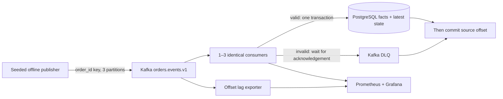

# StreamScale presentation walkthrough

M8 produces `docs/results/current/presentation.pdf` and standalone SVG/PNG
charts from the audited matrix. The complete report and raw-summary CSV sit
beside them. Do not present an incomplete matrix as final results.

Start with the processing path and its correctness rule:



Explain that DB history deduplicates event IDs and late events cannot roll the
latest projection backward. Delivery is at-least-once; the DLQ may contain
multiple copies of a source record. M3/M4 separately tested crash-after-DB-commit
replay, outages and rebalances. M7's controlled restart happens after measurement.

Use the PDF's primary-outcome page to compare the three modes under the same
frozen workload. Dots show three repetitions, diamonds show medians, whiskers
show the observed range. p95 comes from committed SQL timestamps, including
the drained tail. Publishing-window throughput can be lower while correctness
still proves eventual complete delivery. Describe observed results from the
generated report, rather than presuming a winning controller.

Use the resource page and trajectory page to connect the result to ready
replicas, CPU/memory and broker backlog. Compare replica-seconds as well as
latency. Show the scheduled burst and the tail after publication ends. Explain
that Kubernetes resource metrics are delayed samples and that ready pods,
desired replicas and active Kafka group members are different measurements.

For the live demonstration:

```sh
./streamscale.sh status
./streamscale.sh verify
./streamscale.sh ui
```

Open Grafana at http://127.0.0.1:13000/d/streamscale. Pick the current demo UUID
printed by verification; the experiment CSV lists the measured run UUIDs for
historical inspection. The login is in `artifacts/k8s/credentials.json`. Use
`make experiment-audit` to show the completed matrix's integrity checks.

Close with the limits: one shared kind node, three partitions, three repetitions,
short pilot-calibrated local windows, shared broker/SQL bottlenecks, controller
cadence, cache/data carryover and sampled maxima. These measurements describe
this installation and do not establish a production or exactly-once improvement.

Press Ctrl+C to close dashboard forwards, then `./streamscale.sh stop` to stop
both project stacks while keeping their data.
