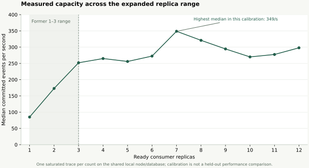
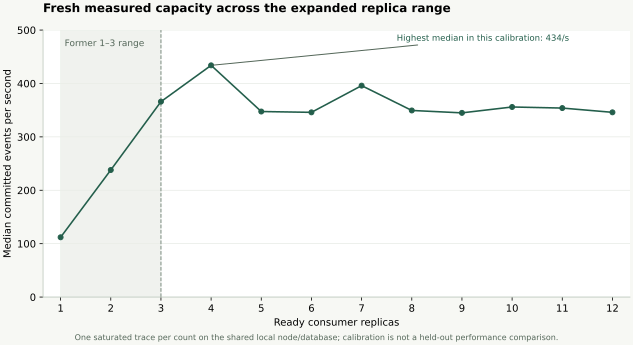

# Twelve-partition capacity evidence

Status: **partial acceptance**, updated 2026-11-10. The current controller fixes
unequal projection windows and passes 213 pipeline / 193 console unit tests.
All 28 manual traces remain compatible; an offline refit reproduces the frozen
forecaster payload exactly. The candidate has not been installed or promoted.
Fresh twelve-policy tuning, the 45-case live suite, browser acceptance, 36 held-out
runs and complete launcher success/reuse remain pending. Additional disk is needed
to preserve old records alongside the remaining measured campaign.

The previous runtime completed twelve policies / twenty-four workloads, all
correctness passing, with tuning infeasible and the default retained. A subsequent
controller correction invalidates those controlled scores for current acceptance.
The initial full live suite passed 41/43; two acceptance assumptions were corrected
and two ownership/restart cases added. See the [current model diagnosis](../../predictive-model-analysis.md),
[current capacity curve](calibration-current.svg), [candidate provenance](corrected-candidate-preparation.json)
and [source compatibility](projection-time-compatible-captures.json).

Measurements below preserve earlier runtime snapshots and distinguish their
provenance. They are separate from the historical three-partition M7 report
under `../current/`; none is a completed current held-out comparison.

The configuration is twelve Kafka input and DLQ partitions, initial one consumer,
and a 1–12 range for autoscaling. Three replicas offered only two upward steps;
twelve provides room to observe scaling decisions, stabilization, manual rescue
and replica-seconds tradeoffs. Matching partition count gives extra consumers
useful work. It does not guarantee proportional throughput.

## Live correctness and scaling

The twelve-consumer check assigned one partition to each ready consumer, then
returned to one ready consumer owning all twelve partitions. Its sale reconciled
9,450 acknowledged attempts, 8,820 unique stored facts, 450 duplicate attempts
and 180 invalid sources with 180 DLQ outcomes. Missing acknowledged IDs, duplicate
stored IDs and state regressions were all zero.

Its exact SQL p95 was **7.286299 seconds**, above the two-second objective.
Correctness passed; the latency objective did not. This was a capacity acceptance
sale with deliberate late/invalid/duplicate events, not a held-out mode comparison.

A repeat through the complete launcher on 2026-11-09 reconciled the same
9,450 attempts and 8,820 facts, again with zero correctness errors and the
12-to-1 ownership check passing. Its exact p95 was **2.988731 seconds**; it also
missed the two-second objective. These repeats demonstrate variability and
control behavior, not an improvement attributed to a mode.

CPU-HPA and lag-KEDA passed independent acceptance workloads with configured
bounds 1–12 and no competing controller. Their first pass reached five ready
replicas each; the repeated launcher pass reached four and five respectively.
These checks do not rank performance.

## Initial per-count calibration

One retained saturated trace per count, 2,000 events/s published for 20 seconds
followed by complete drain. Rates are median offset-commit deltas divided by
actual elapsed time, restricted to stable assignments, matching ready counts and
backlog on every partition. Consumer requests are 100m CPU / 128Mi, limits
500m CPU / 256Mi. These are empirical calibration estimates on the shared local
node/database, not confidence intervals or a replicated throughput benchmark.

| Consumers | Median committed events/s |
| ---: | ---: |
| 1 | 84.98 |
| 2 | 172.97 |
| 3 | 251.95 |
| 4 | 264.96 |
| 5 | 255.96 |
| 6 | 272.46 |
| 7 | 348.82 |
| 8 | 320.96 |
| 9 | 294.45 |
| 10 | 269.96 |
| 11 | 277.45 |
| 12 | 297.94 |

The measured curve flattens and varies beyond three replicas. Seven had the
highest median in this calibration; twelve was lower. The controller uses these
separate measurements and finite queue projections, including when every target
is infeasible. It does not multiply single-consumer throughput by replica count
or automatically prefer twelve during overload. Shared infrastructure contention
and uneven partition assignments remain relevant.

Machine-readable evidence: [acceptance.json](acceptance.json) and
[calibration.csv](calibration.csv). Full ignored traces remain under
`artifacts/predictive/`, with original run IDs, configurations and reconciliations.
Run `./streamscale.sh all --no-ui` to reproduce complete verification and
`./streamscale.sh predictive-evaluate` for the separate held-out comparison.

## Console acceptance

The current console exposes every manual value from zero through twelve, with
keyboard operation and controls that fit a phone. Twelve partition and consumer
series are available, map cards remain separated through rebalances, and retained
three-partition sessions replay with three lanes. The focused production build,
29 web unit tests and nine real-browser capacity/Docs/usability checks passed.
The [README pipeline image](../../images/console-twelve-replicas.png) captures a
real sale with twelve ready consumers and one partition assigned to each.

## Large reconciliation recovery

The larger repeated-burst workload exposed a reconciliation OOM at 70,920 events.
After streaming reads, disk-backed proof tables and bounded telemetry backfill,
that retained sale reconciled with zero correctness errors and no agent restart.
Sampled peak cgroup usage was 228.44 MiB under the unchanged 768 MiB memory limit.
A retained fault-mix sale also reproduced the previous reconciler's results exactly.
See [live recovery](reconciliation-memory-recovery.json) and
[equivalence](fault-mix-reconciliation-equivalence.json). Full fresh-fingerprint
preparation, predictive acceptance and held-out comparison remain pending.

## Fresh collector calibration

All twelve fresh captures reconciled successfully under the bounded-memory
collector. These measurements are separate from the initial calibration above.
Four consumers had the highest median in this calibration (433.95 events/s),
while twelve measured 345.96 events/s. This is one saturated trace per count,
not a replicated ranking or evidence of a causal improvement from the memory fix.
The controller projection selects one replica under quiet synthetic demand and
four as the best available capacity-limited target under synthetic overload.
That deterministic check is separate from held-out latency measurements.

Data and provenance: [current calibration CSV](final-calibration.csv),
[calibration with source run IDs](final-calibration.json), and
[policy projection](policy-capacity-limit-final.json). The twenty-eight retained
manual captures pass the stricter complete-workload gate. Formal comparisons
require completed, unmodified runs with every planned acknowledgement and actual
ML forecasts; correctness of an interrupted sale alone is insufficient.

## Publisher finalization recovery

A later 93,060-event validation capture exposed a separate publisher-finalization
OOM after all broker acknowledgements. The interrupted capture passed SQL
correctness but was excluded from experiments. Finalization, restart recovery
and read-only acknowledgement inspection now stream the payload log; finished
publishers release their manifests. The fresh retry completed with all 93,060
facts and zero missing IDs, duplicate facts or state regressions. The agent had
zero restarts/OOM events; the pod-wide kernel peak read after reconciliation
was 419.66 MiB under its unchanged 768 MiB limit.

Its exact p95 was **286.387491 seconds**, missing the latency objective. This
manual trace demonstrates completion and bounded memory, not improved latency.
[Recovery evidence](publisher-memory-recovery.json) records the measurement scope.
All twelve training and four validation captures are complete. **195 pipeline
unit tests**, **175 console unit tests** and **29 web unit tests** pass, including
eight publisher-memory/inspection regressions. The twelve-key artifact checksum
round trip and installation preflight also pass. The final acceptance gates
remain open as stated above.

## Forecast validation and live tuning

The frozen forecaster uses twelve complete training runs and four disjoint
validation runs. No tuning or evaluation run is used for training. All 48
family/horizon/quantile comparisons, their whole-run identities and model/data
hashes are in [forecast-validation.json](forecast-validation.json) and the
[flat CSV](forecast-validation.csv). Lower pinball loss is better; these scores
measure forecast accuracy, not pipeline latency or savings.

The default 20-second, 90th-percentile forecast gives:

| Validation family | Model loss | Persistence loss | Trend loss |
| --- | ---: | ---: | ---: |
| Steady | 43.75 | 9.53 | 16.08 |
| Ramp | 16.16 | 62.06 | 62.34 |
| Repeated burst | 10.17 | 105.65 | 122.59 |
| Abrupt step | 55.45 | 73.25 | 79.17 |

The model improves on both baselines for the changing workloads in this table,
but performs worse on steady traffic. A history-only predictor cannot anticipate
an unprecedented surge before an observed signal. Validation has one run per
family and provides no confidence interval.

After correcting JSON normalization of the twelve capacity keys, a real trained
tuning sale (`session-20261109220230-ee9726`) completed with all 31,740 planned
acknowledgements, matching SQL facts, zero correctness errors and 135 recorded
forecast samples. It scaled from one through two to four ready consumers. Exact
SQL p95 was **23.634801 seconds**, above the objective. This is tuning evidence,
not held-out performance. A prior checksum-rejected, fallback-only sale remains
preserved and excluded from formal experiments.

The first policy's two tuning workloads both passed correctness, with combined
**2,456.36 replica-seconds** and worst exact p95 **248.151284 seconds**. That policy
is infeasible for the two-second constraint. Preparation must finish all twelve
candidates before publishing an accepted artifact; if none is feasible, it keeps
the conservative default and labels tuning infeasible. No successful optimum or
performance gain is claimed while this campaign is incomplete.

## Consumer startup follow-up

The original consumer checked an entire large manifest in memory before joining
Kafka. One long-lived consumer was OOM-killed when starting a repeated-burst
sale under its unchanged 256 MiB limit. Streaming the same canonical checksum
reduced isolated host-process peak RSS from 214.55 to 24.23 MiB on the exact live
manifest. [The proof](consumer-manifest-memory.json) records its scope and the
nine regressions. Live recovery then started twelve corrected consumers against
that already-drained manifest: one partition each, zero restarts, maximum cgroup
peak 35.84 MiB, and all 92,340 facts preserved after returning to one consumer.
That peak covers startup/idle verification, not processing a new sale.
All 31 local integration checks pass. Fresh live calibration, model preparation and qualification
will replace the interim results before final acceptance; earlier raw runs remain.
