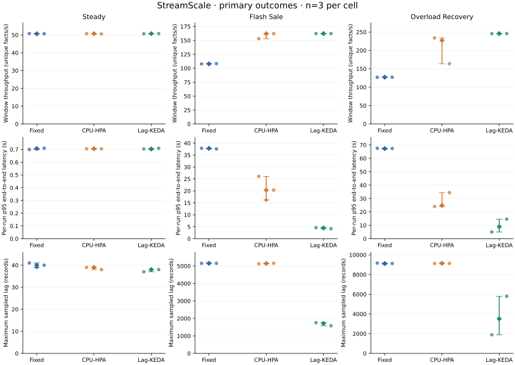
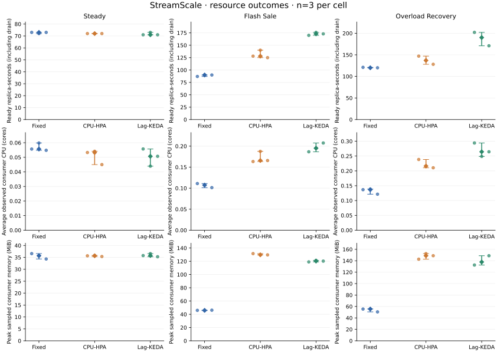
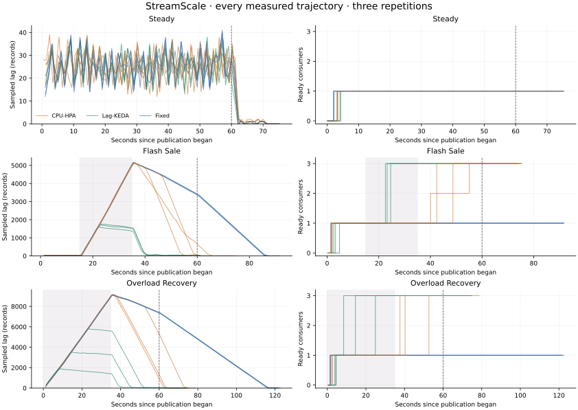

# StreamScale measured results

Campaign `campaign-20261008T113717-328739` completed 2026-10-08T12:54:17.449693Z. All **27 measured runs** passed acknowledgement/SQL/DLQ reconciliation before and after a controlled restart.

Current-campaign excluded attempts: **0**. The independent audit verified 3,818 raw samples, SQL metrics, CSV values, fresh consumer groups and unchanged actual consumer image/resource settings.

Protocol **v2**: pilot capacity 130.50 accepted events/second; frozen steady rate **52**, surge rate **390** events/second. Each scheduled measurement window is 60 seconds, after a separate 30-second cache warmup. Each execution uses a fresh run UUID and consumer group. Measured group startup is included.

Values below are **median [minimum, maximum] across three repetitions**. Latency is the median of three independently computed run p95 values, not a pooled percentile or an average of pod percentiles. No confidence interval or statistical significance is claimed.

| Scenario | Mode | Window throughput (facts/s) | Run p95 latency (s) | Maximum sampled lag |
| --- | --- | ---: | ---: | ---: |
| steady | Fixed | 50.70 [50.65, 50.80] | 0.71 [0.70, 0.71] | 40 [39, 41] |
| steady | CPU-HPA | 50.73 [50.60, 50.78] | 0.70 [0.70, 0.71] | 39 [38, 39] |
| steady | Lag-KEDA | 50.77 [50.70, 50.77] | 0.70 [0.70, 0.71] | 38 [37, 38] |
| flash-sale | Fixed | 107.88 [107.75, 108.32] | 37.81 [37.55, 37.83] | 5150 [5150, 5172] |
| flash-sale | CPU-HPA | 161.97 [152.98, 162.13] | 20.35 [16.19, 26.07] | 5144 [5122, 5156] |
| flash-sale | Lag-KEDA | 162.25 [162.02, 162.25] | 4.49 [4.18, 4.63] | 1714 [1580, 1758] |
| overload-recovery | Fixed | 127.20 [126.85, 127.60] | 67.34 [66.96, 67.52] | 9124 [9072, 9164] |
| overload-recovery | CPU-HPA | 227.25 [163.87, 234.12] | 24.84 [24.03, 34.38] | 9131 [9127, 9176] |
| overload-recovery | Lag-KEDA | 245.68 [245.50, 245.78] | 8.95 [5.02, 14.60] | 3510 [1884, 5794] |

Dots are individual repetitions; diamonds are medians and whiskers span the observed range.

Steady median run p95 values were **Fixed 0.707s, CPU-HPA 0.705s, Lag-KEDA 0.704s**; the maximum observed ready-consumer count was 1. Their small differences are descriptive observations from three repetitions.

For **flash-sale**, Lag-KEDA had the lowest observed median run p95 (4.49 seconds). Its median ready replica-seconds were 173.01, compared with 90.01 for fixed. The paired table shows throughput and lag; these results describe this local campaign only.

For **overload-recovery**, Lag-KEDA had the lowest observed median run p95 (8.95 seconds). Its median ready replica-seconds were 190.02, compared with 120.02 for fixed. The paired table shows throughput and lag; these results describe this local campaign only.

| Scenario | Mode | Ready replica-seconds | Recovery after overload (s) | Observed recoveries |
| --- | --- | ---: | ---: | ---: |
| steady | Fixed | 73.01 [72.01, 73.02] | n/a | n/a |
| steady | CPU-HPA | 72.01 [72.00, 72.01] | n/a | n/a |
| steady | Lag-KEDA | 71.01 [71.00, 73.01] | n/a | n/a |
| flash-sale | Fixed | 90.01 [87.01, 90.04] | n/a | n/a |
| flash-sale | CPU-HPA | 128.02 [124.99, 140.04] | n/a | n/a |
| flash-sale | Lag-KEDA | 173.01 [170.03, 176.00] | n/a | n/a |
| overload-recovery | Fixed | 120.02 [120.01, 121.01] | 86.59 [86.49, 87.67] | 3 |
| overload-recovery | CPU-HPA | 137.01 [128.06, 147.01] | 39.67 [38.31, 43.67] | 3 |
| overload-recovery | Lag-KEDA | 190.02 [171.00, 202.01] | 39.58 [39.48, 39.91] | 3 |

Trajectory lines show each repetition separately, aligned to publication start; shading indicates the scheduled surge and the vertical line the end of the base window. Lines continue through confirmed drain. Ready pods differ from desired replicas and Kafka members.

The primary throughput counts unique facts ingested in the half-open 60-second window. It can be lower during a burst even when every event eventually arrives. `summary.csv` also reports processing-span and drain-inclusive throughput. Latency uses every unique accepted event, including the drained tail. Maximum lag is the maximum sampled sum of three broker-offset partitions. Recovery ends after five distinct fresh zero-lag observations, including their confirmation delay. Missing recovery or scaling response remains missing; it is never filled with zero.

The shared correctness profile delays 5% of the base event count (rounded down and selected from valid events) by ten seconds, alongside invalid/duplicate fixtures. These late attempts extend actual publication to about 70 seconds; `publish_seconds` records the observed duration. The primary window remains the frozen base 60 seconds for every mode. Delayed tail arrivals and the five-fresh-zero criterion constrain measured recovery, so similar recovery times can coexist with very different burst p95 latency. Input-rate labels describe the base logical schedule; fault attempts alter the observed attempt rate. The complete delayed tail is reconciled and included in p95.

Resource integrals cover publication through confirmed drain, before the controlled restart. They use actual observation times with left-step interpolation. Kubernetes CPU metrics are delayed averages, sampled every five seconds; missing leading measurements are disclosed by coverage columns. Maximum memory is a sampled sum across available consumer pods. These resource values are approximations, not billing measurements.

Image `streamscale:c878a885b5640f3b`; build digest `sha256:54edb7d6d408c98fb247052819a057d26df7729b976cc63307c8603cec737f44`; Git `1e3ceee883e175db56e82371f7a6d087b1b7bdd2`; dirty build: `False`. The platform manifest IDs observed in pods are separately preserved in `audit.json`.

Consumer requests: 100m CPU / 128Mi; limits: 500m CPU / 256Mi per replica. Fixed uses one replica; CPU-HPA targets 60% of requested CPU; KEDA targets 100 Kafka records of lag per replica. Autoscaled modes are bounded at 1–3, with three input partitions. Controllers are alternative, never simultaneously attached to the consumer.

The same logical scenario manifest must match across all nine corresponding cells. Seed 4242 randomizes cell order. All rates/windows were frozen before measurement; no measured run was tuned individually. Run IDs, logical hashes, correctness outcomes and exact configuration appear in the companion CSV/protocol/provenance files.

The single kind node shares host CPU with Kafka, PostgreSQL, monitoring and the observer. The host, retained database growth, cache carryover, short windows, metrics/controller cadence and fresh-group startup may affect results. Randomized order reduces but does not eliminate carryover. Three repetitions give a small descriptive sample. Sampled peaks can miss intermediate maxima. This v2 60-second calibration is not directly comparable to the original 120-second fixed-rate proposal. The controlled restart occurs after measurement; crash-during-commit replay was separately exercised in M3/M4. The pipeline remains at-least-once, and DLQ redelivery can create extra copies. No production, multi-node or exactly-once improvement is claimed.

Reproduce with `./streamscale.sh all --no-ui`; reuse validates retained raw evidence. For new measurements use `./streamscale.sh experiments --fresh`, then `./streamscale.sh analysis`. Raw artifacts are ignored locally and identified by `artifacts/experiments/latest.path`. See [the protocol](../../experiments.md) and [presentation walkthrough](../../presentation.md).
